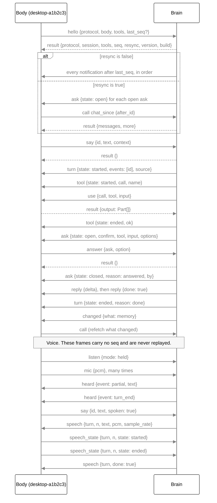

# Tagalong contract v3

The wire contract between the brain (Python) and its bodies (the desktop app, the browser add-on, WhatsApp).
This file is the source of truth: the TypeScript package in `ts/` (`@tagalong/contract`), the Python types in `brain/src/brain/protocol.py`
and the samples in `examples/` follow it, and a change here comes first. The sample file convention is in [examples/README.md](examples/README.md).

## Principles

- Bodies talk only to the brain, never to each other.
- The contract carries facts and the model's own words, never canned lines. Every word Scout says comes from the model; a turn may end with no reply at all.
- The twenty-seven messages below (fourteen body to brain, thirteen brain to body; `cancel` is one in each direction) do not change when a body, tool, expert or Home screen is added. Beyond these, new things arrive as tools, event names or `changed` names. Fifteen carry the conversation, nine carry voice and two carry get to know me.
- Single user, but never an open door: every `hello` carries a `token` the brain checks before anything else, and a brain reached over the network is encrypted and pinned by its certificate fingerprint. There are no accounts.

## Transport

- One websocket per body, JSON-RPC 2.0, one JSON object per text frame. The brain has two listeners. The loopback one is plain `ws://127.0.0.1:47321` (address configurable) for bodies on the brain's own machine, which read the local token from the brain's home folder (`local-token`). The network one is `wss://<host>:47323`, off unless `TAGALONG_NETWORK=1`: TLS 1.2 or later with the brain's self-signed certificate, which a body pins by its SHA-256 fingerprint instead of checking names. Plain `ws` on the network port fails.
- Heartbeat is the websocket ping. A body that stops answering pings is offline.
- Unknown fields are ignored by both sides. Field names are `snake_case`.
- Optional fields are omitted when absent, never sent as `null`; a `null` on an optional field gets `invalid_params`. The only nullable fields are `turn.body` and `reply.body` (always present, may be `null`) and the free-form `data` and `context`.
- Either side may send requests. Request ids are chosen by the sender (string or integer) and only need to be unique per connection and direction.
- The first message on a connection must be `hello`, or `pair` where the listener offers it (see Pairing). Anything else before it gets `invalid_request` and the connection is closed.

## Versioning

One integer, `protocol`, currently `3`. The brain accepts only its own version: a body whose `protocol` is any other integer (including `2`) fails `hello` with `version_mismatch` (the error's `data.protocol` is the brain's version) and the brain closes the connection. The body tells the user to update. Adding an optional field does not bump the version; removing or changing the meaning of one does.

## Shared shapes

```text
Tool  { name, description, input_schema, confirm?, effect? }  (confirm: true | "always")
Part  { type: "text", text }
    | { type: "image", mime, data }
    | { type: "file",  mime, name?, data }
Body  { id, kind, name, display? }
```

- **Tool.** `name` is unique within the body that declares it: lowercase letters, digits, `_` and `-`, never `__`, at most 48 characters. `input_schema` is a JSON Schema object. `confirm: true` means the brain asks the user before running it, until the person unlocks the tool on Home or a preference names it (see Asks). `confirm: "always"` (for delete and overwrite) asks every time and is for the person alone: the brain never lets it be set to Auto and no preference approves it. `effect` is `"read"` or `"change"` and is omitted when the body does not say (never null): `read` means the tool only looks and changes nothing, `change` means it alters something. The brain uses it to decide how to ask.
- **Tool names across bodies.** Bodies declare plain names (`list_windows`). The brain exposes them to the model as `<body id>__<name>` (`desktop-a1b2c3__list_windows`) so two bodies never collide and the name stays within the model API's allowed characters. The brain calls the body with the plain name. Brain tools have no prefix and never contain `__`.
- **Part.** `data` is base64. A future source, `ref` (an uploaded file id instead of `data`), is reserved: v1 senders always send `data`, and v1 receivers reject a part with `ref` and no `data` with `invalid_params`. Adding `ref` later needs no message change.
- **Body.** `id` is unique per install and stable across restarts: made once and kept for the desktop and the browser, never a fixed word for them (the desktop uses `desktop-` and six hex digits, `desktop-a1b2c3`); lowercase letters, digits and `-`, at most 32 characters. Two bodies with one id are one body, and the second knocks off the first; `kind` is the body type (`desktop`, `browser`, `whatsapp`; a new kind needs no contract change), `name` is shown to the person to tell bodies apart (the desktop sends the PC's name, the browser `Chrome`). The WhatsApp bridge is the exception: it sends the fixed id `whatsapp`, because there is only ever one bridge per brain. A browser body makes its id `<browser>-<4 random chars>` (`chrome-7k2f`) once per install, so two browsers or profiles are two bodies. `display` is optional (omitted or `true` by default, never null): `display: false` says the body shows nothing. Replies, asks and broadcasts are still sent to it and it ignores them; the brain never counts it when it picks where to show a turn or whether anyone can be asked.

## Limits

| What                              | Limit                                                        | Error        |
| --------------------------------- | ------------------------------------------------------------ | ------------ |
| One part's decoded `data`         | 5 MB                                                         | `over_limit` |
| All parts in one message, decoded | 20 MB                                                        | `over_limit` |
| Replay window                     | the last 500 notifications or 24 hours, whichever is smaller | `resync`     |
| One `mic` frame's decoded `pcm`   | 64 KB                                                        | dropped      |
| One `know_me_start` PDF, decoded  | 10 MB (base64 up to 13,981,016 characters)                   | `over_limit` |

The same caps apply to `output` parts returned from `use` and `call`. An oversize or malformed `mic` frame is dropped, never answered.

## Messages

Request means a JSON-RPC request that gets a result or an error. Notification means no reply.

### Body → brain

| Method          | Kind         | Params                                                                                    | Result                                                                        |
| --------------- | ------------ | ----------------------------------------------------------------------------------------- | ----------------------------------------------------------------------------- |
| `hello`         | request      | `{ protocol, token, body: Body, tools: Tool[], last_seq? }`                               | `{ protocol, session, tools: Tool[], seq, resync, version?, build?, addrs? }` |
| `pair`          | request      | `{ code, device: { name, kind } }` (before `hello`; see Pairing)                          | `{ device_id, token }`                                                        |
| `tools`         | request      | `{ tools: Tool[] }`                                                                       | `{}`                                                                          |
| `say`           | request      | `{ id, text?, parts?: Part[], context?, spoken?, speed?, interrupted?: { turn, heard } }` | `{}`                                                                          |
| `event`         | notification | `{ name, data? }`                                                                         |                                                                               |
| `call`          | request      | `{ tool, input }`                                                                         | `{ output: Part[] }`                                                          |
| `answer`        | request      | `{ ask, option, text?, check_back_at? }`                                                  | `{}`                                                                          |
| `cancel`        | notification | `{ turn }`                                                                                |                                                                               |
| `listen`        | request      | `{ mode: "held" \| "always" }`                                                            | `{}`                                                                          |
| `mic`           | notification | `{ pcm }`                                                                                 |                                                                               |
| `unlisten`      | notification | `{}`                                                                                      |                                                                               |
| `hush`          | notification | `{}`                                                                                      |                                                                               |
| `speech_state`  | notification | `{ turn, n?, state: "started" \| "ended" \| "paused" \| "idle" }` (no `seq`)              |                                                                               |
| `know_me_start` | request      | `{ github?, pdf?: { name, data } }` (at least one; `data` is base64)                      | `{ joined }`                                                                  |

- **hello.** Opens the connection. `token` is required (a non-empty string): the local token for a body on the brain's machine. The brain checks the version, then the token, then the shape; a missing, non-string, wrong or revoked token gets `unauthorized` (before any shape error, so the reply never echoes the caller's input) and the connection is closed, and nothing else on the connection is handled first. A body with no token yet (the brain has not written `local-token`) sends no hello: it closes the socket and dials again on its retry timer. `tools` are the body's tools. The result carries the brain's own tools (the ones a body may `call`; the Home tools, listed in the Home tools table of docs/brain/README.md), the shared `session` id, the latest `seq` in this body's outbox, and `resync` (see Replay). `version` and `build` are optional: the brain's own version and build id (the app version when packaged, a hash of its source in a dev checkout). The desktop compares them with its own to tell whether the brain is from an older version; a brain that omits them is treated as older. They add no version bump. `addrs` is optional too: the other `host:port` addresses this brain can be dialed at, today its Tailscale address on the network port (only the network listener sends it, and only when the machine has one); the desktop adds them to the addresses it tries, so the brain stays reachable away from home. It adds no version bump. A second `hello` on the same connection gets `invalid_request`.
- **pair.** Trades a one-time code for a device token. It is the only request a connection may send before `hello`, and only where pairing is offered (see Pairing); anywhere else it gets `method_not_found`. `device.kind` is `desktop`, `browser`, `node` or `mcp_client` and `device.name` is 1 to 40 characters. The result's `token` is shown once and is the `token` that device sends in `hello` from then on. The brain closes the connection after answering `pair`, whatever the answer. A wrong, used, expired, wrong-kind or rate-limited code gets `unauthorized`.
- **tools.** The body's tool list changed; it replaces the whole list.
- **say.** The user said something. At least one of `text` or `parts` is present. `context` is free-form (active window, selection) and goes to the model as-is; each body documents its own context in its doc, never here. `spoken: true` means the user spoke, so the reply is read aloud (see Voice). `speed` (0.5 to 2) is optional and only matters on a spoken `say`; the voice is the brain's own choice (Home picks it), so a body never names one. `id` is the body's own id for this say, unique across all bodies, so a UUID (a non-empty string): the brain dedupes by event id across bodies. The result is `{}`: it only confirms the brain has the say. A say whose `id` the brain already knows (a resend after a reconnect) starts nothing and joins nothing. The reply streams as notifications, and the `turn` frames say which turn took the say: its id is in the `events` of that turn's `started` or `joined` frame. If a turn is already running and shows this body, the say joins it: the model sees the new message at its next step, and the brain sends a `turn` frame with `state: "joined"` and the say's id in `events`. A say that arrives after the turn's last read gets its own turn instead (`started`). A `say` from a different body than the one showing the running turn does not join it: it gets its own turn after, and its reply goes to the body that sent it. If the daily budget is spent, the turn still starts and ends at once with `reason: "over_budget"`, so every body learns it the same way. A `say` from a body with `display: false` still starts or joins the turn, but the turn's `body` is chosen as for a turn the brain starts itself (see `turn`); the sender does not become the body the user last talked to. `interrupted {turn, heard}` says the owner talked over turn `turn` after the body had finished playing chunks up to `heard` (the highest `speech.n` it completed; `0` when none); the brain keeps what was said, hands the unsaid rest to the model with this turn and ignores a `turn` it no longer knows.
- **event.** A fact the body noticed (window changed, user idle). Names are free-form and documented per body. The brain decides whether it matters; most events get no reaction. Two names are shared by every body: `back {idle_seconds}` (the user returned after at least 5 minutes idle) and `focus {app, title}` (the front window changed; throttled; an empty `app` clears it, sent when the body may not report the front window). The desktop also sends `read_aloud {on, speed?, system_voice?}` on connect and whenever its voice setting changes: while `on` is true the brain speaks every turn that body displays (typed replies, the hello, wake remarks), at `speed` unless a `say` carries its own; `system_voice` means the user picked the body's own voice, so the brain sends text-only `speech` frames and never loads its voice. The brain keeps the latest per body across reconnects, and the desktop resends it on every connect. The desktop also sends `reading {rows}`: how it reads the screen, one row per capability (`window-text` or `text-from-pictures`) with its engine, where it runs (`this-pc`) and a state (`working`, `needs-language-pack` or `not-working`); a `needs-language-pack` row carries the person's Windows display `language` tag and their `profile_languages`. It is sent on connect, after an install and on request. The browser body also sends `tab {title, url}` (the owner switched tabs; URL without query or fragment; throttled) and `download {name, state}` (state is `complete` or `interrupted`); the brain keeps the latest of each and never wakes for them. The WhatsApp body sends `ask_closed {via: "tap" | "answer"}` (the person tapped or answered a question the brain no longer holds) and `many_pending {asks}` (a typed reply arrived while `asks` (2 or more) questions were open and could not be matched to one); the brain wakes Scout for each, which words any reply itself, and the bridge sends no text of its own for either. A body coming online is not an event: the brain learns it from the connection itself.
- **call.** The body runs one of the brain's tools directly (Home reading settings, for example). Unknown tool gets `unknown_tool`.
- **answer.** The user answered an ask. `option` is one of the ask's `options` strings; `text` is optional free text. An ask that is already closed or never existed gets `not_found`; an `option` not in the list gets `invalid_params`, unless the ask accepts typed answers (an expert's question) and `text` is non-empty: then any `option` is taken and the typed text is the answer. `check_back_at` (an ISO time, only with `option: "not_now"`; any other option with it gets `invalid_params`) is when the person wants to be asked again; absent, the brain checks back in 30 minutes. `not_now` leaves the ask open: the brain sends the same ask again (same `id`, new `seq`) with the new `check_back_at` and `check_back_by: "person"`. `stop_task` ends the ask's task and closes the ask.
- **cancel.** Stop this turn. The brain ends it with `turn { state: "ended", reason: "cancelled" }`. A turn that has already ended or never existed is ignored.

### Brain → body

| Method           | Kind         | Params                                                                                                                                                                  | Result               |
| ---------------- | ------------ | ----------------------------------------------------------------------------------------------------------------------------------------------------------------------- | -------------------- |
| `use`            | request      | `{ call, tool, input }`                                                                                                                                                 | `{ output: Part[] }` |
| `cancel`         | notification | `{ call }`                                                                                                                                                              |                      |
| `reply`          | notification | `{ seq, turn, body, delta }` or `{ seq, turn, body, done: true }`                                                                                                       |                      |
| `turn`           | notification | `{ seq, turn, body, state: "started" \| "joined" \| "ended", reason?, events?, source?, tasks? }`                                                                       |                      |
| `tool`           | notification | `{ seq, turn, call, name, state: "started" \| "ended", ok?, summary? }`                                                                                                 |                      |
| `ask`            | notification | `{ seq, id, state: "open", turn?, text, options: string[], confirm?, tool?, input?, free_text?, recommended? }` or `{ seq, id, state: "closed", reason, option?, by? }` |                      |
| `changed`        | notification | `{ seq, what }`                                                                                                                                                         |                      |
| `approved`       | notification | `{ seq, tool, text, preference }`                                                                                                                                       |                      |
| `heard`          | notification | `{ event: "speech_start" \| "partial" \| "final" \| "turn_end", text? }` (no `seq`)                                                                                     |                      |
| `voice`          | notification | `{ status: "loading" \| "ready" \| "failed", message?, progress? }` (no `seq`)                                                                                          |                      |
| `speech`         | notification | `{ turn, n?, text, pcm?, sample_rate? }` or `{ turn, done: true }` (no `seq`)                                                                                           |                      |
| `speech_control` | notification | `{ action: "pause" \| "resume" \| "clear", turn? }` (no `seq`)                                                                                                          |                      |
| `know_me_status` | notification | `{ sources: { name, state: "waiting" \| "reading" \| "done" \| "failed", gap? }[], done, portrait? }` (no `seq`)                                                        |

- **use.** Run one of this body's tools. `tool` is the plain name the body declared. On failure the body returns an error: `tool_failed`, `cancelled`, `timeout` or `invalid_params`.
- **cancel.** Stop that `use`. The body answers the `use` with `cancelled`, or with its result if it had already finished.
- **reply.** Scout's words for a turn, streamed. `body` follows the same rule as `turn.body`. Zero or more `delta` chunks, then exactly one `done` if any delta was sent. A turn that ends with no `reply` at all is a silent turn, and that is allowed.
- **turn.** A turn started, took another say or event (`joined`), or ended. `body` is the body the user was talking to: it shows and speaks the reply; other bodies may show it in history. For a turn the brain starts itself, `body` is the body the person is using now, else the body the event's task came from, else the first online body that displays; the phone (`whatsapp`) is chosen only when no screen is online, and a body with `display: false` never. With no body that displays, the event waits and no turn starts. A `say` from a body with `display: false` gets the same choice. With only display-less bodies online a Scout permission ask is still opened and saved, and parked at once: it is sent again to the first body that displays and joins. A job's ask waits with its job. `reason` on `ended` is one of `done`, `cancelled`, `error`, `over_budget`, `step_cap`. `started` and `joined` carry `events` (the ids of the events the turn took: a body's say ids, or the brain's own event ids) and `source`: who the events came from, a body id (`desktop-a1b2c3`) or one of `scout`, `job:<id>`, `timer:<id>`, `setup:<id>`, `loop:<app>`, `tool:<name>`. `source` names the origin for the record; it does not decide what a body shows. A body shows a turn live only when it took that body's own say (one of its say ids is in `events`); it shows any other turn quietly: no thinking state or bubble, and the words, if any, as a single remark at the end. A `joined` frame carrying the body's own say ids makes the turn live from then on. (`isInternalSource` in `@tagalong/contract` still tells a brain source from a body id.) `started` and `joined` may also carry `tasks` (`[{id, kind, title}]`, `title` may be `null`): the tasks those events belong to, Ask tasks left out; the field is left out when there are none (a say alone). A body may show it; it never has to. `ended` carries none of `events`, `source` or `tasks`.
- **tool.** A tool call in a turn started or ended, so bodies can show what Scout is doing. `name` is the full name as the model sees it. `summary` is a short line for people; it comes from the tool's result, not a template.
- **ask.** Scout needs the user. `state: "open"` carries the question; every connected body shows it. When the ask closes, the brain sends `state: "closed"` to every body so the prompt disappears everywhere. An open ask may carry `free_text: true` (the body shows a text box; an answer may send any `option` with non-empty `text`) and `recommended` (one of `options`, otherwise the ask is invalid; the body marks it and offers it first). `reason` is `answered`, `timeout` or `cancelled`; with `answered`, `option` is the chosen option and `by` is the body id that answered, or `side_check` when Scout's own look approved the ask first (`option` is then `allow`). First answer wins. For a confirm (see Asks and confirm) the ask has `confirm: true`, `tool` and `input`, and its options are exactly `["allow", "deny"]` or exactly `["allow", "always", "deny"]`, in that order. A card that belongs to a task (`task: { id, title? }`, `title` omitted while the task has none) adds `"not_now"` and `"stop_task"` after its own options, in that order, and may carry `check_back_at` (ISO time the brain will look at it again), `check_back_by` (`scout` or `person`) and `urgent` (true when it may reach the person in quiet hours).
- **changed.** Something the bodies display changed (`settings`, `memory`, `permissions`, `approvals`, `key`, `jobs`, `job_activity`, `events` (an event was saved or changed state; refetch the Home tool `events_waiting`), an expert's name). `what` is free-form, never a fixed list. Bodies refetch through `call`. `job_activity` means a job's step log moved (sent at most every 250 ms with a trailing one, so the last step is never missed); pull the new steps with the Home tool `job_activity`, whose JSON also carries `parts` (`[{id, expert, state, reason, started_at, ended_at}]`, one per expert hand-off in the job; an old job has one), `title`, `closed_at`, a `part` and `source` on each step (a step Scout took itself has `kind: "tool"`, part `scout`, `source` `app:<app id>` or `scout:<tool>`, and status `done`, `failed` or `refused`), `result` (Scout's own result for the job, or `null`), and `watch` (Scout's watch list for the job, `[{text, done}]` or `null`); the Home tool `job_report` (`{job, part}`) returns `{"text": str | null}`, one part's masked report, for the job page's Reports tab; both are fields of tool results, not a frame, so the contract does not change. The Home tool `tasks_list` (`{include_ended?: bool}`, ended tasks only when true) returns `{"tasks": [{id, kind, state, title, source, caused_by, chain, created_at, ended_at}]}`, newest first, Ask tasks left out; `chain` is `[{kind, source}]`, the event that caused the task and then the one that caused that, to a depth of 5; again a tool result, not a frame. The Home tool `list_permissions` rows carry `mode` (`off`, `ask` or `auto`) `source` (`built_in`, `body:<id>` or `app:<id>`), `source_name` (the body's declared `name` or the app's name, for the group heading) and `person_only` (the tool may be Off or Ask, never Auto), and `set_permission` accepts `off`; these are fields of tool results, not a frame, so the contract does not change. Home tool `list_memories` (newest 700) rows carry `category`, `span_start` and `span_end` (null for an old or undated row); these too are tool-result fields, so the contract does not change. `key` means the Anthropic key was set; refetch `key_status`. The Home tool `set_api_key` carries the key in its `input`, so a body must not log or store that call; its reply is only `{"status": "ok" | "invalid" | "unreachable"}` and no reply ever holds any part of the key.
- **approved.** Scout let a tool run because a saved preference covered it. `tool` is the tool name, `text` the one-line summary of what ran, `preference` the preference sentence that applied. The bubble can show it so the person sees why no ask appeared. The brain sends it every time its side-check approves an ask, for Scout's brain, body and connected-app tools and for Claude Code's permission asks, always once and never "always".

## Voice

The brain hears and speaks; a body only handles sound. Audio rides in the same JSON text frames as everything else (base64), so there is one frame type and no binary transport. The nine voice messages are live-only: they carry no `seq`, are never stored in the outbox and never replayed, and go only to the current connection, so a reconnect cannot bring back old audio.

- **pcm.** Base64 of little-endian int16 samples, mono. `mic.pcm` is 16 kHz; `speech.pcm` is at its `sample_rate`. A `mic` frame decodes to at most 64 KB (see Limits); an oversize or malformed frame is dropped silently, never answered.
- **listen.** The body starts streaming its mic. `mode` is `held` (the user holds a key) or `always`. A new `listen` replaces the earlier one, from this body or any other: the brain keeps one listening session at a time. A brain without voice answers `method_not_found`; the body treats that as "voice unavailable" and falls back to typing and its own system voice.
- **mic.** One audio frame. Frames from a body that has not sent `listen`, or that has sent `unlisten`, are dropped with no error.
- **unlisten.** The mic closed. In `held` mode the brain finishes what it already has first. A disconnect counts as `unlisten`.
- **hush.** The user cut Scout off: the brain stops speaking the current reply for this body. The text reply still shows.
- **speech_state.** What the body's speaker is doing, so the brain knows whether Scout is talking. `started` and `ended` come once per chunk, with `n` the chunk's `speech.n`; `paused` when the speaker holds (the person talked over Scout, or `speech_control` said so); `idle` when it has nothing left to say or was cleared. After a `resume` the held chunk reports `started` again. `n` is absent on `paused` and `idle`. The brain feeds it to presence; the mouth's own state is only the fallback when no body reports.
- **speech_control.** The brain asks the speaker to `pause` (hold where it is and keep the unplayed chunks), `resume` (carry on from the held chunk) or `clear` (drop the chunk playing and the queue; with `turn`, drop only that turn's chunks, playing or queued, and leave other turns to speak). Sent to the body that shows the turn. A body without a speaker ignores it. Unlike `hush`, `clear` is not the person cutting Scout off, so the body does not answer it with a `hush`.
- **know_me_start.** The person asked Scout to read their public presence. `github` is a username (letters, digits and hyphens, at most 39); `pdf` is a LinkedIn "Save to PDF" file as base64 (at most 10 MB decoded). At least one is required, else `invalid_params`; bad base64 is `invalid_params` and an oversize PDF `over_limit`. One run goes at a time: a start while a run is going joins it (`joined: true`) and the sender gets the current status at once; the inputs of a joining start are ignored.
- **know_me_status.** The current state of the run, sent live to each body that started or joined it, not replayed after a reconnect (a run does not survive a restart). One entry per source in order; `gap` says in plain words why a source gave nothing; `done: true` ends the run, and `portrait` carries the written portrait when there is one.
- **heard.** What the brain heard, sent to the listening body: `speech_start`, `partial` (running text), `final` (text of one stretch of speech), `turn_end` (the person finished). The body decides what to send as a spoken `say`.
- **voice.** The state of the brain's listening models (the ears only), sent to the listening body. `loading` may carry `progress` (0 to 1) while models download, `failed` carries a plain `message`. The body keeps working while it loads or after it fails; the next `listen` retries.
- **speech.** Scout's reply read aloud, chunk by chunk (a chunk is a few whole sentences), sent to the body that shows the turn (`turn.body`). `n` numbers a turn's spoken chunks from 1 (absent on `done`). `pcm` and `sample_rate` come together; a `speech` with `text` and no `pcm` means "say this with your own voice" (used while the brain's voice loads or after it fails; the brain sends no `voice` frame for the speaking voice). `{ turn, done: true }` ends that turn's speech.
- **Privacy.** Audio goes only to your own brain and is never stored; with the brain on this computer it never leaves it.

## Sessions and turns

- There is one session across all bodies, and it survives a brain restart. A second body joins the same conversation; `hello` returns its id. The id is informational in v1: bodies never send it back.
- One turn runs at a time. A turn starts with `say`, or with the brain itself (a scheduled routine, for example), which waits until no turn is running. A `say` during a running turn joins it (see `say`). Every notification about a turn carries its `turn` id.
- Every brain → body notification goes to every connected body, except `use` and its `cancel` (only to the body that owns the tool) and the voice notifications (only to the listening or displaying body).
- Two connections with the same body id: the newer `hello` wins and the brain closes the older connection. Running `use` calls on the old connection fail with `body_offline`.

## Seq, outbox and replay

- Every brain → body notification except `cancel` and the live-only notifications (`heard`, `voice`, `speech`, `speech_control`, `know_me_status`) carries `seq`: an integer that rises by one per notification in that body's outbox, starting at 1. Bodies process notifications in `seq` order.
- The brain keeps an outbox per body id (the replay window in Limits). A body that reconnects sends `last_seq` in `hello`.
- If every notification after `last_seq` is still in the outbox, the brain answers `hello` with `resync: false` and then sends them in order before anything new.
- If some are gone (too old, too many, the brain restarted, or `last_seq` is higher than the brain's latest `seq`), the brain answers `resync: true`. The body drops what it was showing for open turns and asks. The brain then sends only what is still live: an `ask` (`open`) for every open ask. A turn still running is not announced again; its later frames arrive as usual.
- A first `hello` with no `last_seq` gets `resync: false` and only live state, as above.
- A reply longer than the replay window cannot be replayed, so a resync does not bring back words that streamed while the body was away. A body that shows chat reads the saved chat with the Home tool `chat_since` (`{after_id?: string, limit?: int}` to `{messages: [{id, role, text, source, body, at}], more: bool}`, assistant replies only, oldest first; rows that call a tool are left out because their words are mid-turn, and saved rows carry no turn link; with `after_id` it returns the oldest `limit` rows after it and a body pages on with the last id while `more` is true; `after_id` absent or unknown gives the last `limit`, default 20, at most 50). A body keeps the id of the newest reply it has shown (refreshed with `limit: 1` when its link comes up and after each turn), calls `chat_since` with it on `resync`, and shows each reply said on its own body kind once. No clocks are compared. It is a tool call, not a frame, so the contract does not change.
- A connection that cannot keep up has a bounded write queue: past its cap the brain drops the oldest speech audio chunks (`speech` frames carrying `pcm`) first. A frame with `seq`, a speech `done` and the voice status frames are never dropped.

## Asks and confirm

- A tool with `confirm: true` asks until the person unlocks it on Home or a preference names it: code guards, not the model. The brain pauses the call and sends an `ask` with `confirm: true`, `tool`, `input` and options `["allow", "deny"]`, or `["allow", "always", "deny"]` when the tool is not locked. Bodies show the options they get as their own buttons. `always` means allow this call, and the brain saves `auto` for that tool so later calls run without asking; it is never offered for a locked tool.
- A tool's `input` may carry facts for a body to lay out as a card (for example an app's `official`, `community`, `publisher`, `runs`, `sign_in`, `licence` and `reviewed`; see `examples/valid/brain.ask.params.open-confirm-community-app.json`). No field is required and unknown ones are ignored, so this is not a schema change.
- The ask's `text` is the model's own words from the step that made the call (for example "I'll delete these 3 old logs"), with no extra model call and no template. If the model wrote nothing, `text` is empty and the body shows the tool and its input.
- `deny` fails the call with `denied`. A Scout ask with nobody to answer stays open (a body that joins is sent it again) and the call returns a waiting line; a job's ask waits with its job. The model is told either way.
- Every other ask is the model's own: it words the question and chooses the options.

## Pairing

A device on another machine gets its token by pairing, once, with a code the owner makes on the brain (`tagalong pair` in a terminal, or Home's "Pair a device").

- The code is in a link, `tagalong://pair?addr=<host:port>&fp=<64 hex>&code=<secret>`, shown as text and as a QR code. `addr` is the network listener, `fp` the SHA-256 fingerprint of the brain's certificate (the body pins it before sending anything) and `secret` is 32 URL-safe characters. A code lasts 10 minutes and works once; only its hash is stored. After five failed attempts in a minute every code is refused until the minute is over.
- The body connects to `wss://<addr>`, checks the certificate against `fp`, sends `pair`, saves the `token` and `device_id`, and reconnects with `hello`. The brain binds the body id of that `hello` to the device: another device cannot take it.
- The browser add-on cannot read the local-token file or pin a certificate, so it pairs on the loopback listener with a 6-digit code (`kind: "browser"`) that Home shows or `tagalong pair --kind browser` prints, typed into its popup. A browser code is accepted only on the loopback listener (a `TAGALONG_BRAIN_ADDR` bound to a non-loopback address would expose it); every other kind is refused there.
- Revoking a device (Home, or `device_revoke`) closes its live connection at once, and its next `hello` gets `unauthorized`.
- There is no typed code: a code typed on another machine would need a password-authenticated key exchange (SPAKE2) with a maintained library on both sides, and no Node implementation has had a release since 2022. The link and QR are the only way to pair across machines.
- The network listener accepts device tokens only. The local token, which grants everything on the brain's own machine, is honoured on the loopback listener alone.

## Errors

JSON-RPC error objects: `{ code, message, data? }`. `message` is a plain sentence for logs; bodies show their own words, never `message`.

| Name               | Code   | When                                                                  |
| ------------------ | ------ | --------------------------------------------------------------------- |
| `parse_error`      | -32700 | The frame is not valid JSON                                           |
| `invalid_request`  | -32600 | Not a valid request, or a message before `hello`, or a second `hello` |
| `method_not_found` | -32601 | Unknown method                                                        |
| `invalid_params`   | -32602 | Params do not match this spec                                         |
| `internal_error`   | -32603 | A bug on the receiving side                                           |
| `version_mismatch` | -32000 | `hello` with another `protocol`; `data.protocol` is the brain's       |
| `unknown_tool`     | -32001 | `call` or `use` names a tool that does not exist                      |
| `not_found`        | -32002 | An ask, turn or call id that does not exist or is already closed      |
| `denied`           | -32003 | The user refused a confirm                                            |
| `timeout`          | -32004 | A tool or ask took too long                                           |
| `cancelled`        | -32005 | The work was cancelled                                                |
| `body_offline`     | -32006 | The body went offline while a `use` was running                       |
| `tool_failed`      | -32007 | The tool ran and failed; `data` may carry details                     |
| `over_limit`       | -32008 | A part or message is over the size limits                             |
| `unauthorized`     | -32009 | `hello` with a missing, wrong or revoked token, or a refused `pair`   |

## The TypeScript client

`@tagalong/contract` (`protocol/ts`) exports `BrainClient`, the body's end of this contract, shared by the desktop and the browser body. Besides `addr`, `body`, `tools`, `openSocket` and the callbacks (`onNotification`, `onUse`, `onStatus`, `onResync`), it takes:

- **`body`** (`{ id, kind, name }`): sent in hello as given; its id prefixes the client's request ids.
- **`seqStore`** (`{ load(): Promise<number | null>, save(seq) }`): where the body keeps the last seq it saw, so a restart sends `last_seq`. Without it the client keeps `last_seq` in memory only. The browser keeps it in `chrome.storage.session`, which survives a worker restart but not a browser restart.
- **Voice calls.** `listen(mode)` resolves when the brain accepts and rejects with its error (`method_not_found` when it has no voice). `mic(pcm: Int16Array)` returns whether the frame was sent, `unlisten()`, `hush()` and `speechState(params)` are fire and forget; all are dropped while offline. `heard`, `voice`, `speech` and `speech_control` reach `onNotification` without touching `last_seq`. `knowMeStart(params)` resolves `{ joined }` (rejects `BrainOffline` unless online); subscribe with `onKnowMeStatus` before calling it, because the first status arrives before the reply; `onKnowMeStatus(listener)` returns an unsubscribe function, and `know_me_status` also reaches `onNotification`, with no `last_seq`.
- **`target`** is a function returning `{ scheme: 'ws' | 'wss', addr }`, asked on every dial: the desktop rotates through a paired brain's addresses with it. `token` is sent in `hello` as given. `pairOverSocket` (in `pair-link.ts`) is the one `pair` handshake the desktop and the add-on share.
- **`keepalive`** (`{ everyMs, tool }`): while online, the client calls one of the brain's own tools every `everyMs` so a sleepy host (a Chrome service worker) stays awake. The browser uses `{ everyMs: 20_000, tool: 'spend_today' }`.

## A typical session

One body from connect to a spoken answer. Each arrow is a frame named in the tables above. Frames in the conversation part go through the outbox with a `seq`; the voice frames are live only.



Read it top to bottom: `hello` first, then a replay or a resync, then a `say` that the brain answers as a turn (a body tool arrives as `use`, a permission as `ask`), a `changed` notice that only says something moved (the body refetches it with `call`), and last the voice frames beside a spoken turn.

## Examples

A desktop connects, the user asks for something on screen, Scout looks and answers. The desktop's body id is a per-install one such as `desktop-a1b2c3`.

```json
→ {"jsonrpc":"2.0","id":1,"method":"hello","params":{"protocol":2,"body":{"id":"desktop-a1b2c3","kind":"desktop","name":"My PC"},"tools":[{"name":"read_window_text","description":"Read the text of one window","input_schema":{"type":"object","properties":{}}}]}}
← {"jsonrpc":"2.0","id":1,"result":{"protocol":2,"session":"s1","tools":[],"seq":0,"resync":false}}
→ {"jsonrpc":"2.0","id":2,"method":"say","params":{"id":"e1","text":"what's this error?","context":{"window":"VS Code"}}}
← {"jsonrpc":"2.0","id":2,"result":{}}
← {"jsonrpc":"2.0","method":"turn","params":{"seq":1,"turn":"t1","body":"desktop-a1b2c3","state":"started","events":["e1"],"source":"desktop-a1b2c3"}}
← {"jsonrpc":"2.0","method":"tool","params":{"seq":2,"turn":"t1","call":"c1","name":"desktop-a1b2c3__read_window_text","state":"started"}}
← {"jsonrpc":"2.0","id":"b1","method":"use","params":{"call":"c1","tool":"read_window_text","input":{}}}
→ {"jsonrpc":"2.0","id":"b1","result":{"output":[{"type":"text","text":"ImportError: No module named requests"}]}}
← {"jsonrpc":"2.0","method":"tool","params":{"seq":3,"turn":"t1","call":"c1","name":"desktop-a1b2c3__read_window_text","state":"ended","ok":true}}
← {"jsonrpc":"2.0","method":"reply","params":{"seq":4,"turn":"t1","body":"desktop-a1b2c3","delta":"That's a missing import"}}
← {"jsonrpc":"2.0","method":"reply","params":{"seq":5,"turn":"t1","body":"desktop-a1b2c3","done":true}}
← {"jsonrpc":"2.0","method":"turn","params":{"seq":6,"turn":"t1","body":"desktop-a1b2c3","state":"ended","reason":"done"}}
```

A confirm answered on one body closes on all of them.

```json
← {"jsonrpc":"2.0","method":"ask","params":{"seq":7,"id":"a1","state":"open","turn":"t2","text":"I'll delete old.log.","options":["allow","deny"],"confirm":true,"tool":"desktop-a1b2c3__delete_file","input":{"path":"C:/Users/me/old.log"}}}
→ {"jsonrpc":"2.0","id":3,"method":"answer","params":{"ask":"a1","option":"deny"}}
← {"jsonrpc":"2.0","id":3,"result":{}}
← {"jsonrpc":"2.0","method":"ask","params":{"seq":8,"id":"a1","state":"closed","reason":"answered","option":"deny","by":"desktop-a1b2c3"}}
```

With `always` on offer, answering it allows the call and saves `auto` for that tool:

```json
← {"jsonrpc":"2.0","method":"ask","params":{"seq":9,"id":"a2","state":"open","turn":"t3","text":"I'll move a.txt into Archive.","options":["allow","always","deny"],"confirm":true,"tool":"desktop-a1b2c3__move_file","input":{"from":"C:/Users/me/a.txt","to":"C:/Users/me/Archive"}}}
```

A body that is too far behind.

```json
→ {"jsonrpc":"2.0","id":1,"method":"hello","params":{"protocol":2,"body":{"id":"chrome-7k2f","kind":"browser","name":"Chrome"},"tools":[],"last_seq":12}}
← {"jsonrpc":"2.0","id":1,"result":{"protocol":2,"session":"s1","tools":[],"seq":740,"resync":true}}
```

## Left to the builder

- How the outbox is stored (memory or disk); a brain restart may simply mean `resync`.
- Timeouts for asks (a Scout permission ask has no timeout: it waits in its turn for 5 minutes, then parks until answered or until its deadline `ask_wait_hours`; a job's ask waits with its job), and the exact JSON Schema subset tools may use. A body that joins with no `last_seq`, or is told `resync`, is sent every ask still open again as a fresh `ask` (`open`) with a new `seq`; a body that reconnects without `resync` gets the ask once, from the backlog. The brain's `use` timeout is 30 s; a `use` that times out or whose turn is cancelled gets `cancel {call}` (no `seq`).
- How the brain turns events, context and tool results into model input.
